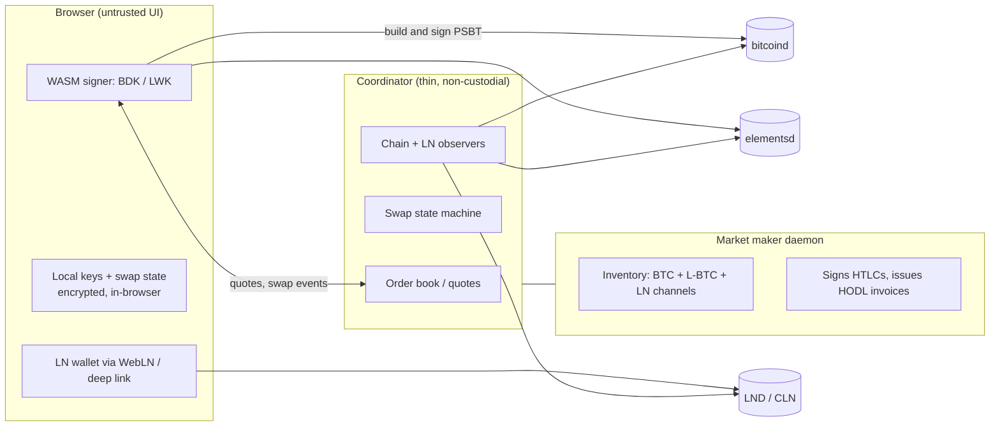

# swapsite - plan

## 1. Goal

Coordinate trustless swaps across BTC, Liquid (L-BTC) and Lightning through a
website that never holds funds or keys.

Non-goals (for now):

- Being a wallet provider for the user's long-term funds.
- Market making at scale / multi-venue liquidity.
- Custody, accounts, or balances.

## 2. Core design

The three-way matrix is not three protocols. It is **one primitive - a
hashlocked leg** - instantiated on two kinds of backend:

| Leg backend                | Mechanism                                                        |
| -------------------------- | ---------------------------------------------------------------- |
| On-chain (BTC **or** L-BTC) | P2WSH HTLC: hashlock claim path + timelocked refund path          |
| Lightning                  | BOLT11 payment, hash `H` (maker needs HODL-invoice support)       |

A swap is any pair of legs sharing one preimage `H`.

- **BTC <-> LN** and **L-BTC <-> LN** are both submarine swaps. L-BTC is just a
  different on-chain backend (1 min blocks, confidential outputs).
- **BTC <-> L-BTC** is the same idea with two on-chain legs and no LN.
- Adding a pair is configuration, not a new protocol.

**Timelock rule.** For legs A and B sharing `H`, the initiator's refund timeout
must be strictly longer:

$$T_A > T_B + m$$

where $m$ covers confirmation plus the counterparty's action on the slower
chain. Never use equal timeouts. Per-chain margins: BTC ~10 min blocks
(24-72 h), Liquid ~1 min blocks (1-6 h).

**Direction naming.** Each pair has two directions:

- *Submarine* - user pays on-chain, receives Lightning (or pays a third-party
  invoice). The preimage-claim path belongs to the maker; the user's only
  fallback is the timelocked refund.
- *Reverse submarine* - user pays Lightning, receives on-chain. The
  preimage-claim path belongs to the user.

## 3. Roles

| Role            | Who runs it          | Holds                                            |
| --------------- | -------------------- | ------------------------------------------------ |
| Taker           | end user             | their keys, per-swap preimage, swap state        |
| Maker           | liquidity provider   | BTC + L-BTC inventory, LN channels, HODL invoices |
| Coordinator     | the website operator | no keys, no funds - quotes, state, chain observation |

## 4. What the website does and must never do

| It does                                             | It must **never** do                                 |
| --------------------------------------------------- | ---------------------------------------------------- |
| Order book / quotes (spread + fee)                  | Hold user keys or funds                              |
| Swap state machine (create -> funded -> settle)     | Learn a taker preimage unless it is the counterparty |
| Chain observation, confirmation tracking            | Be required to complete or refund a swap             |
| Serve the client-side signer and script builder     | Custody the taker's Lightning balance                |
| Serve recovery / status pages                       | Be the only copy of swap parameters                  |

Design goal: *the website is the only thing you are allowed to lose.*

## 5. Trust model

- **No custody risk.** Hashlock + timelock. A malicious coordinator can cause
  denial of service or liveness failure, not theft.
- **Liquidity / solvency risk.** The maker must actually hold inventory. This is
  economic, not cryptographic.
- **Price risk.** The quote is the maker's. You trust the rate, not the funds.
  No oracle is required by the protocol.
- **Timeout risk.** Mis-set timelocks are the one parameter that can lose money.
  Treat as a hard invariant with tests.
- **Liquid peg.** L-BTC <-> BTC via atomic swap needs no federation trust.
  Routing through a peg round-trip inherits the federation's trust - avoid it.
- **Regulatory.** Running the maker is likely money transmission in many
  jurisdictions. Running a neutral coordinator is less exposed, but not zero.

## 6. Wallet requirements

Short answer: **the Lightning side needs no custom wallet, the on-chain side
needs script-aware signing, and that signing should be delivered inside the
website rather than as an app the user installs.**

Breakdown by step:

| Step                                     | Who signs        | Does a plain wallet work?                       |
| ---------------------------------------- | ---------------- | ----------------------------------------------- |
| Fund the on-chain HTLC address           | taker            | Yes - it is a send-to-address                   |
| Refund on-chain leg after `T` (failed)   | taker            | No - needs the script path, unless presigned    |
| Claim on-chain leg with `H` (reverse)    | taker            | No - needs the script path **and** the preimage |
| Pay a BOLT11 invoice                     | taker            | Yes - any LN wallet, or WebLN                   |
| Issue HODL invoice, lock/claim HTLC      | maker            | n/a - the maker runs a full node                |

Consequences:

1. **Lightning: no custom wallet.** The taker only ever *pays* a BOLT11
   invoice. HODL-invoice support is required only on the maker. This keeps the
   taker's LN requirements to "any wallet that can pay an invoice".
2. **On-chain: yes, effectively.** Funding can come from any wallet (a plain
   send-to-address), but both exit paths need a script-path spend. The claim
   path cannot be usefully presigned (it needs the live funding outpoint and the
   preimage), so script-aware signing is mandatory for the receive direction.
3. **Deliver it as a built-in signer.** Ship a WASM signer (BDK for BTC, LWK for
   L-BTC) in the frontend holding an ephemeral per-swap key. This is "a custom
   wallet", but it lives in the website - the user installs nothing and the key
   never leaves the browser. Offer a passphrase / hardware signer for larger
   amounts later.
4. **Presigned refunds** can remove the taker's own signing requirement for the
   *send* direction: sign the CLTV refund at creation and let the taker
   broadcast it later. Cost: fee-bumping complexity (CPFP) and more complex key
   handling. Treat as an optimization, not v0.
5. **Two things the taker always needs besides keys:** chain observation (an
   Esplora-style API, since the browser cannot read the P2P network) and a
   broadcast relay. Neither is a trust issue - a lying observer or relay can
   only censor - but both are required for the taker to exit unilaterally.

External-wallet interop (PSBT handoff to a hardware wallet, deep links) is a
later milestone, not a v0 requirement.

## 7. Architecture

## 8. Roadmap

| Phase | Scope | Status |
| ----- | ----- | ------ |
| M0 | Local regtest environment in Docker (BTC + Lightning). | done |
| M1a | On-chain HTLC leg: script builder, spends, timelock invariant, state machine. | done, see [m1.md](m1.md) |
| M1b | Lightning leg: HODL invoices, hold/settle, joined to the on-chain leg. | done, see [m1.md](m1.md) |
| M1c | Maker daemon: watch both legs, drive the machine, automate refunds. | done, see [m1.md](m1.md) |
| M1d | WASM taker signer plus chain observation and broadcast relay. | not started |
| M2 | Coordinator + web UI: quotes, single-maker order book, swap lifecycle, recovery page. | not started |
| M3 | L-BTC legs: elements regtest, LWK signer. L-BTC <-> LN falls out of M1. | not started |
| M4 | BTC <-> L-BTC direct: two on-chain legs, no LN, chain-aware margins. | not started |
| M5 | Multiple makers, Nostr discovery. | not started |

Registry of decisions:

- Start with **BTC <-> LN only** (M1). It exercises every mechanism that the
  other pairs reuse.
- **M1d (next).** The WASM taker signer, plus the chain observation and
  broadcast relay a taker needs.
- **M1c done:** the maker daemon settles and refunds swaps on its own, from
  observed reality, and survives being restarted mid-swap.
- **M1b done:** one swap now completes end to end on regtest. The maker holds an
  invoice, funds an HTLC, settles, and the taker claims with the revealed
  preimage, netting the amount it paid.
- **Regtest in Docker** is the testing substrate from M0 onward.
- **Rust for the protocol core.** One implementation serves the maker daemon and,
  compiled to WASM, the browser-side taker signer.
- **Three crates: domain, adapters, entry points.** `swapsite-core` has no
  sockets, filesystem or subprocesses; the impure work sits behind the `Chain`
  and `LightningNode` traits in `swapsite-adapters`. This is what keeps the WASM
  signer a compile target rather than a refactor.
- **Persist signed transactions before broadcasting them.** A maker that crashes
  mid-swap must be able to finish or undo the swap from disk alone.
- **Observed reality wins over the local record.** Recovery adopts terminal
  states seen on-chain or on Lightning, and can never adopt a non-terminal one.
- **Heights only for refund timeouts.** Time-based locktimes are rejected when a
  swap is constructed.

## 9. Risks and open questions

- Browser key security: XSS in the frontend is a total loss for an in-flight
  swap. Mitigate with a minimal, static, dependency-pinned client and CSP.
- Refund automation: dead swaps are the main UX failure. Needs a background job
  plus a user-facing "Recover" page.
- Fee bumping: a presigned refund can become un-broadcastable if fees rise.
  Needs CPFP or anchor outputs.
- Maker LN liquidity: HODL invoices lock maker capital for up to `T`.
- Coordinator trust for status: the coordinator must learn of claims from chain
  observation, not from a counterparty's word.
- Reorg handling differs per chain and per direction.
- Regulatory exposure of operating the maker.
