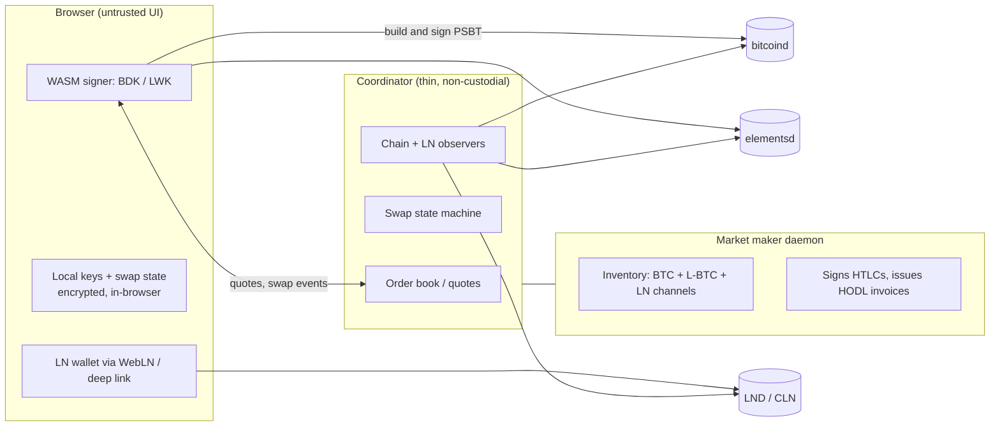

# swapsite - plan

## 1. Goal

Coordinate trustless swaps across BTC, Liquid (L-BTC) and Lightning through a
website that never holds funds or keys.

Non-goals (for now):

- Being a wallet provider for the user's long-term funds.
- Market making at scale / multi-venue liquidity.
- Custody, accounts, or balances.

## 2. Core design

The three-way matrix is not three protocols. It is **one primitive - a
hashlocked leg** - instantiated on two kinds of backend:

| Leg backend                | Mechanism                                                        |
| -------------------------- | ---------------------------------------------------------------- |
| On-chain (BTC **or** L-BTC) | P2WSH HTLC: hashlock claim path + timelocked refund path          |
| Lightning                  | BOLT11 payment, hash `H` (maker needs HODL-invoice support)       |

A swap is any pair of legs sharing one preimage `H`.

- **BTC <-> LN** and **L-BTC <-> LN** are both swaps. L-BTC is just a
  different on-chain backend (1 min blocks, confidential outputs).
- **BTC <-> L-BTC** is the same idea with two on-chain legs and no LN.
- Adding a pair is configuration, not a new protocol.

**Timelock rule.** For legs A and B sharing `H`, the initiator's refund timeout
must be strictly longer:

$$T_A > T_B + m$$

where $m$ covers confirmation plus the counterparty's action on the slower
chain. Never use equal timeouts. Per-chain margins: BTC ~10 min blocks
(24-72 h), Liquid ~1 min blocks (1-6 h).

**Direction naming.** Each pair has two directions:

- *btc2ln* - user pays on-chain, receives Lightning (or pays a third-party
  invoice). The preimage-claim path belongs to the maker; the user's only
  fallback is the timelocked refund.
- *ln2btc* - user pays Lightning, receives on-chain. The
  preimage-claim path belongs to the user.

## 3. Roles

| Role            | Who runs it          | Holds                                            |
| --------------- | -------------------- | ------------------------------------------------ |
| Taker           | end user             | the per-swap claim key, the preimage once settled, swap state |
| Maker           | liquidity provider   | BTC + L-BTC inventory, LN channels, HODL invoices, the per-swap refund key and preimage |
| Coordinator     | the website operator | no keys, no funds - quotes, state, chain observation |

## 4. What the website does and must never do

| It does                                             | It must **never** do                                 |
| --------------------------------------------------- | ---------------------------------------------------- |
| Order book / quotes (spread + fee)                  | Hold user keys or funds                              |
| Swap state machine (create -> funded -> settle)     | Learn a taker preimage unless it is the counterparty |
| Chain observation, confirmation tracking            | Be required to complete or refund a swap             |
| Serve the client-side signer and script builder     | Custody the taker's Lightning balance                |
| Serve recovery / status pages                       | Be the only copy of swap parameters                  |

Design goal: *the website is the only thing you are allowed to lose.*

## 5. Trust model

- **No custody risk.** Hashlock + timelock. A malicious coordinator can cause
  denial of service or liveness failure, not theft.
- **Liquidity / solvency risk.** The maker must actually hold inventory. This is
  economic, not cryptographic.
- **Price risk.** The quote is the maker's. You trust the rate, not the funds.
  No oracle is required by the protocol.
- **Timeout risk.** Mis-set timelocks are the one parameter that can lose money.
  Treat as a hard invariant with tests.
- **Liquid peg.** L-BTC <-> BTC via atomic swap needs no federation trust.
  Routing through a peg round-trip inherits the federation's trust - avoid it.
- **Regulatory.** Running the maker is likely money transmission in many
  jurisdictions. Running a neutral coordinator is less exposed, but not zero.

## 6. Wallet requirements

Short answer: **the Lightning side needs no custom wallet, the on-chain side
needs script-aware signing, and that signing should be delivered inside the
website rather than as an app the user installs.**

Breakdown by step:

| Step                                     | Who signs        | Does a plain wallet work?                       |
| ---------------------------------------- | ---------------- | ----------------------------------------------- |
| Fund the on-chain HTLC address           | taker            | Yes - it is a send-to-address                   |
| Refund on-chain leg after `T` (failed)   | taker            | No - needs the script path, unless presigned    |
| Claim on-chain leg with `H` (reverse)    | taker            | No - needs the script path **and** the preimage |
| Pay a BOLT11 invoice                     | taker            | Yes - any LN wallet, or WebLN                   |
| Issue HODL invoice, lock/claim HTLC      | maker            | n/a - the maker runs a full node                |

Consequences:

1. **Lightning: no custom wallet.** The taker only ever *pays* a BOLT11
   invoice. HODL-invoice support is required only on the maker. This keeps the
   taker's LN requirements to "any wallet that can pay an invoice".
2. **On-chain: yes, effectively.** Funding can come from any wallet (a plain
   send-to-address), but both exit paths need a script-path spend. The claim
   path cannot be usefully presigned (it needs the live funding outpoint and the
   preimage), so script-aware signing is mandatory for the receive direction.
3. **Deliver it as a built-in signer.** Ship a WASM signer (BDK for BTC, LWK for
   L-BTC) in the frontend holding an ephemeral per-swap key. This is "a custom
   wallet", but it lives in the website - the user installs nothing and the key
   never leaves the browser. Offer a passphrase / hardware signer for larger
   amounts later.
4. **Presigned refunds** can remove the taker's own signing requirement for the
   *send* direction: sign the CLTV refund at creation and let the taker
   broadcast it later. Cost: fee-bumping complexity (CPFP) and more complex key
   handling. Treat as an optimization, not v0.
5. **Two things the taker always needs besides keys:** chain observation (an
   Esplora-style API, since the browser cannot read the P2P network) and a
   broadcast relay. Neither is a trust issue - a lying observer or relay can
   only censor - but both are required for the taker to exit unilaterally.

External-wallet interop (PSBT handoff to a hardware wallet, deep links) is a
later milestone, not a v0 requirement.

## 7. Architecture

## 8. Roadmap

| Phase | Scope | Status |
| ----- | ----- | ------ |
| M0 | Local regtest environment in Docker (BTC + Lightning). | done |
| M1a | On-chain HTLC leg: script builder, spends, timelock invariant, state machine. | done, see [m1.md](m1.md) |
| M1b | Lightning leg: HODL invoices, hold/settle, joined to the on-chain leg. | done, see [m1.md](m1.md) |
| M1c | Maker daemon: watch both legs, drive the machine, automate refunds. | done, see [m1.md](m1.md) |
| M1d | WASM taker signer plus chain observation and broadcast relay. | done, see [m1.md](m1.md) |
| M2 | Coordinator + web UI: quotes, single-maker order book, swap lifecycle, recovery page. | done, see [m2.md](m2.md) |
| M3 | L-BTC legs: elements regtest, LWK signer. L-BTC <-> LN falls out of M1. | not started |
| M4 | BTC <-> L-BTC direct: two on-chain legs, no LN, chain-aware margins. | not started |
| M5 | Multiple makers, Nostr discovery. | not started |
| M6 | btc2ln direction (BTC on chain to LN): the taker deposits first, no bond. | done, see [regtest.md](regtest.md) |

Registry of decisions:

- Start with **BTC <-> LN only** (M1). It exercises every mechanism that the
  other pairs reuse.
- **M2 done:** the coordinator quotes, brokers, serves the page and serves the
  wasm module; it passes the quoted fee straight to the maker rather than keeping
  a margin, it records a swap before answering, and it recovers a taker's swaps
  by claim pubkey. The page verifies its own deposit and signs its own claim.
- **Nothing dev-only is on by default.** The endpoint that pays a taker's invoice
  on its behalf is behind `--dev-pay`, because using it means the coordinator
  learns a preimage it would never see in production.
- **The maker publishes the preimage once the swap settles.** Settling *is* the
  reveal - it is what tells the Lightning network the payment is claimable - so
  from that moment the preimage is public, and withholding it only costs a taker
  who paid from another wallet a manual copy-paste. It is published on settled
  swaps and on nothing else, and the field is absent rather than null before
  then, so a swap's public view cannot be read as "the secret is out".
- **The taker pays a bond before anything is funded.** Funding first is what
  makes walking away free: an abandoned swap would cost the taker nothing while
  parking the maker's capital for the whole locktime. So the maker offers the
  terms, the taker pays a non-refundable Lightning bond covering the entry and
  exit fees, and only then does a deposit exist. The bond's hash is
  `sha256(sha256(preimage))`, so settling it reveals nothing about the on-chain
  leg. The cost is deliberate and bounded: the taker trusts the maker to fund
  after taking the bond, which is why the bond is priced at cost rather than at
  profit. This is the arrangement the Lightning Engineering pages describe as a
  "non-refundable Lightning payment upfront ... to compensate for the
  opportunity cost of funds being locked up".
- **The btc2ln direction has no bond.** The taker's deposit is the
  collateral: a taker that walks away has parked its own money until the
  locktime, so the maker is not exposed to a free option the way it is when it
  funds first. The mirror of that option is the maker's, which is why it may pay
  only while `has_margin(locktime, height + cltv_delta, MIN_MARGIN_BLOCKS)`
  holds: a payment made any later would expire after the taker can refund.
- **The refund has to outlive the payment.** `LegTimelocks` refuses any swap whose
  on-chain timeout does not clear the invoice's final CLTV delta by
  `MIN_MARGIN_BLOCKS`, both when an offer is built and when a record is read back
  off disk, and the maker refuses to fund a bond that arrived after the deadline
  it will not fund past. The taker is the last line of defence, because it is the
  one that can see the current height when it pays: it refuses a swap whose
  remaining window is too short. Without this, a maker can refund the deposit and
  still settle a payment made against it, taking both legs - which is what an
  earlier version of this code did, on regtest, before the rule was enforced.
  The maker's default margin is the CLTV delta plus the floor plus a payment
  window, measured from the last height it will fund at, so the taker's window
  never shrinks below that window however slow the bond is.
- **Recovery is a verdict, not a service.** Nobody can claim for the taker, so
  what the taker gets is a judgement - drawn from its own preimage, the chain,
  and the HTLC's own locktime - of whether a move is left. The page acts on it
  without asking, because a claim only ever moves value towards the taker.
- **Passing a deadline is a race, not a loss.** The hashlock path is not
  timelocked, so a claim is valid at any height and the deadline only opens the
  maker's refund. A verdict that called that "lost" would be wrong, and wrong in
  the direction that makes a taker give up on money that is still theirs.
- **The taker checks the deposit itself.** The maker's records only follow the
  refund the maker built, so a refund from anywhere else is invisible off-chain.
  That is why the relay grew an unspent-output query rather than the coordinator
  growing an opinion.
- **Split the client JS by dependency, not by audience.** The page and the shell
  drive the same code, but only one of them can import `node:fs`; a shared file
  that imported it made the browser refuse the module outright.
- **M1d done:** the taker runs in wasm with zero imports, verifies the deposit
  itself and signs its own claim; a relay only reads the chain and broadcasts.
- **M1c done:** the maker daemon settles and refunds swaps on its own, from
  observed reality, and survives being restarted mid-swap.
- **M1b done:** one swap now completes end to end on regtest. The maker holds an
  invoice, funds an HTLC, settles, and the taker claims with the revealed
  preimage, netting the amount it paid.
- **Regtest in Docker** is the testing substrate from M0 onward.
- **Rust for the protocol core.** One implementation serves the maker daemon and,
  compiled to WASM, the browser-side taker signer.
- **Three crates: domain, adapters, entry points.** `swapsite-core` has no
  sockets, filesystem or subprocesses; the impure work sits behind the `Chain`
  and `LightningNode` traits in `swapsite-adapters`. This is what keeps the WASM
  signer a compile target rather than a refactor.
- **Persist signed transactions before broadcasting them.** A maker that crashes
  mid-swap must be able to finish or undo the swap from disk alone.
- **Observed reality wins over the local record.** Recovery adopts terminal
  states seen on-chain or on Lightning, and can never adopt a non-terminal one.
- **A signal the record cannot hold has to be read from the chain.** The maker's
  refund state only ever describes the refund it built itself, and a
  transaction stays confirmed after its output is spent, so the deposit's own
  unspent status is observed separately. An unsettled invoice plus a spent
  deposit is a refund, because a claim would have needed the preimage and the
  preimage only comes from settling.
- **The taker gets entropy from the page, not from the module.** `rand` is a
  feature of the domain crate, off in the wasm build, so the module imports
  nothing and needs no toolchain beyond `rustup target add wasm32-unknown-unknown`.
- **A relay is only a relay.** It observes and broadcasts. It is never asked to
  be trusted: the taker checks the deposit script and signs its own spend.
- **Heights only for refund timeouts.** Time-based locktimes are rejected when a
  swap is constructed.

## 9. Risks and open questions

- btc2ln claim timing: the maker pays only with `MIN_MARGIN_BLOCKS` between
  the payment's expiry and the taker's locktime, so a claim always has room to
  land first. If the maker stalls past that room the taker refunds and keeps the
  payment, the asymmetry the reverse direction's bond exists to reduce.
- Browser key security: XSS in the frontend is a total loss for an in-flight
  swap. Mitigate with a minimal, static, dependency-pinned client and CSP.
- Refund automation: dead swaps are the main UX failure. Needs a background job
  plus a user-facing "Recover" page.
- Fee bumping: a presigned refund can become un-broadcastable if fees rise.
  Needs CPFP or anchor outputs.
- Maker LN liquidity: HODL invoices lock maker capital for up to `T`.
- Bond asymmetry: the bond is non-refundable, so a maker that collects one and
  then never funds costs the taker the bond. Reputation and pricing the bond at
  cost are the current answer; a bond that the taker can reclaim if no deposit
  appears would remove the asymmetry entirely.
- Coordinator trust for status: the coordinator must learn of claims from chain
  observation, not from a counterparty's word.
- Reorg handling differs per chain and per direction.
- Regulatory exposure of operating the maker.
